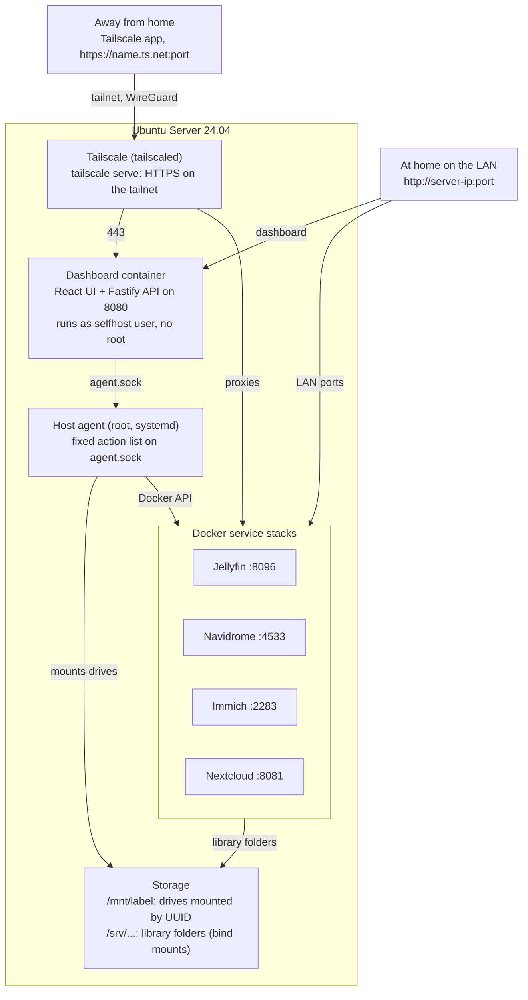

# Self-Hosting Starter Kit: Detailed Plan

Nov 20, 2026 · @Kareem

## Overview

The kit is one open-source repo that turns a fresh Ubuntu Server 24.04 machine into a home media and file server, managed entirely from a web dashboard. A user runs one install command, then never needs the terminal again.

**Goals**

- Install with a single command and finish setup in a browser wizard
- Install, start, stop and update Jellyfin, Navidrome, Immich and Nextcloud from the dashboard, each optional
- Show live status (online or offline) and logs for every service
- Manage drives and mount them to the right media folders without the terminal
- Reach every service securely from outside the home without opening router ports

**Non-goals for v1:** other distributions, ARM boards, discrete GPU support, single sign-on, multiple admin accounts, scheduled backups, public sharing or internet exposure, and multi-server setups.

**Target user:** someone comfortable following a guide to install Ubuntu on an old PC or mini PC, but not comfortable with Docker, fstab or reverse proxies.

**Decisions made**

| Area | Decision | Why |
| --- | --- | --- |
| Repo | [KShammout632/self-hosting-starting-kit](https://github.com/KShammout632/self-hosting-starting-kit) | Project home |
| License | GPL | Keeps the kit and its forks open source |
| OS | Ubuntu Server 24.04 LTS | Most beginner documentation, support until 2029 |
| Hardware | x86-64 mini PC or old PC; Intel integrated graphics used when present, no discrete GPU support | Quick Sync helps Jellyfin transcoding at no extra setup cost |
| Remote access | Tailscale only, no public sharing mode | No port forwarding, no domain, encrypted by default |
| Accounts | One dashboard admin account; each service manages its own users | Simpler; avoids mobile-app SSO problems |
| Backups | Not in v1; only automatic pre-update snapshots for rollback | Keeps v1 focused; full backups come later |
| Services | Docker Compose, one stack per service | Isolated, easy to toggle and update |
| Dashboard stack | Node + TypeScript (Fastify) and React (Vite) | One language across the repo, shared types |

## Architecture

The kit has three parts on the server: an unprivileged dashboard container, a small root agent, and one Docker Compose stack per service. Tailscale carries remote traffic; LAN traffic goes straight to service ports.



Only the host agent runs as root; everything else asks it.

The dashboard never touches Docker or disks directly: every change goes through the agent's fixed action list over a local socket.

**Filesystem layout**

| Path | Holds |
| --- | --- |
| `/opt/selfhost/agent` | Agent bundle and Node runtime |
| `/opt/selfhost/services/<name>` | Rendered compose files per service |
| `/opt/selfhost/config/<name>` | Service configs, databases, `.env` secrets |
| `/opt/selfhost/backups` | Pre-update snapshots for rollback |
| `/var/lib/selfhost/selfhost.db` | Dashboard settings and audit log (SQLite) |
| `/mnt/<label>` | Mounted data drives |
| `/srv/media/{movies,tv,home-videos,music}`, `/srv/photos`, `/srv/nextcloud` | Library folders mapped to drives |

## Repo structure and tech stack

The repo is a pnpm workspaces monorepo in TypeScript, so the web UI, API and agent share one set of types and validation schemas.

```
self-hosting-starting-kit/
  install.sh                 # bootstrap installer (bash)
  apps/
    web/                     # React + Vite dashboard UI
    api/                     # Fastify dashboard backend
    agent/                   # root host agent (systemd service)
  packages/
    shared/                  # Zod schemas, types, service catalog types
    catalog/                 # service definitions (compose templates + metadata)
      jellyfin/
      navidrome/
      immich/
      nextcloud/
  deploy/
    selfhost-agent.service   # systemd unit
    dashboard.compose.yml    # compose file for the dashboard container
  docs/                      # user guide, troubleshooting, contributing
  test/                      # VM-based end-to-end tests
```

| Layer | Choice | Notes |
| --- | --- | --- |
| UI framework | React 19 + TypeScript, Vite | Built to static files served by the API |
| UI components | shadcn/ui + Tailwind | Accessible, easy to restyle |
| Data fetching | TanStack Query | Polling for status, cache invalidation after actions |
| Routing | TanStack Router or React Router | Typed routes |
| API server | Fastify | Schema validation, fast streaming for logs |
| Validation | Zod (shared package) | Same schemas in UI, API and agent |
| Live updates | Server-Sent Events | Log streams and status pushes; simpler than WebSockets |
| Docker control | dockerode (agent only) | Containers, logs, events, image pulls |
| System info | systeminformation | CPU, RAM, disk, temperature |
| Auth | argon2 + signed session cookie | Single admin account in v1 |
| Settings store | SQLite (better-sqlite3) | Settings, audit log, service state |
| Bundling | tsup / esbuild | API and agent ship as single JS files |
| Runtime for agent | Bundled Node 22 LTS binary | Avoids depending on Ubuntu's Node version |
| Tests | Vitest, Playwright, Multipass or QEMU VMs | Unit, UI and full install tests |

**Service catalog.** Each service in `packages/catalog` has a `manifest.ts` (name, description, ports, required folders, health check URL, GPU needs, first-login tips) and a `compose.yml.tmpl` template. The agent renders templates with user settings into `/opt/selfhost/services/<name>/`. Adding a new service later means adding a folder, not changing core code.

## Installer

The installer is a single idempotent bash script: running it twice is safe, and running it again later repairs a broken install.

**How users run it**

```bash
curl -fsSL https://raw.githubusercontent.com/KShammout632/self-hosting-starting-kit/main/install.sh -o install.sh
less install.sh   # optional: read it first
sudo bash install.sh
```

Publish a checksum for each tagged release, and have the script download a pinned release tarball rather than the `main` branch.

**Steps**

1. **Preflight checks.** Ubuntu 24.04 (`/etc/os-release`), x86-64, running as root, at least 4 GB RAM and 20 GB free on the system disk, internet access. Fail with a plain-English message and a docs link.
2. **Base packages.** `ca-certificates curl gnupg jq smartmontools`, plus `unattended-upgrades` enabled for security updates.
3. **Docker Engine.** Add Docker's official apt repo, install `docker-ce` and `docker-compose-plugin`. Remove the Ubuntu `docker.io` package if present.
4. **Tailscale.** Add Tailscale's apt repo and install it, but do not log in yet. The wizard handles login.
5. **Intel GPU.** If `/dev/dri/renderD128` exists, install `intel-media-va-driver-non-free` and `vainfo`, and record GPU support in settings.
6. **System user and folders.** Create the `selfhost` user and group. Create `/opt/selfhost/{services,config,backups}`, `/var/lib/selfhost`, and `/srv/{media/movies,media/tv,media/home-videos,media/music,photos,nextcloud}`.
7. **Agent.** Copy the bundled agent and Node binary to `/opt/selfhost/agent`, install `selfhost-agent.service`, enable and start it.
8. **Dashboard.** Start the dashboard container via `docker compose`, published on port 8080 on the LAN interface.
9. **Firewall.** Enable `ufw` with SSH allowed. Docker-published ports bypass ufw, so service ports are protected by the router (no port forwarding) rather than by ufw; see Security model.
10. **Finish.** Generate a one-time setup code, print the dashboard URL (`http://<lan-ip>:8080`) and the code, and log the install to `/var/log/selfhost-install.log`.

**Uninstall script.** `sudo bash uninstall.sh` stops and removes all containers and the agent, and asks separately before deleting configs or touching `/srv` (default: keep all media).

## Host agent

The agent is the only component with root access, and it only performs actions from a fixed, validated list. The dashboard asks; the agent decides whether the request is allowed and does the work.

**Runtime**

- systemd unit `selfhost-agent.service`, `Restart=always`, starts after `docker.service`
- Listens on `/run/selfhost/agent.sock`, owned `root:selfhost`, mode `0660`
- The dashboard container mounts only that socket (never `/var/run/docker.sock`)
- Logs every action to journald and to the audit table in SQLite

**Protocol.** Newline-delimited JSON over the Unix socket. Each request has an `id`, an `action` and typed arguments, checked against a Zod discriminated union in `packages/shared`. Streaming actions (logs, image pulls) send multiple `chunk` messages, then `end`.

```ts
{ id: "a1", action: "service.restart", service: "jellyfin" }
{ id: "a1", ok: true }
{ id: "a2", action: "logs.stream", service: "immich", tail: 500 }
{ id: "a2", chunk: { ts: "...", stream: "stderr", line: "..." } }
```

**Action list (v1)**

| Group | Actions |
| --- | --- |
| Services | `service.install`, `service.uninstall`, `service.start`, `service.stop`, `service.restart`, `service.update`, `service.status` |
| Logs | `logs.stream`, `logs.download` |
| Disks | `disk.list`, `disk.mount`, `disk.unmount`, `disk.format`, `disk.smart` |
| Folders | `folder.assign`, `folder.usage` |
| Network | `tailscale.status`, `tailscale.login`, `tailscale.logout`, `tailscale.serve.apply` |
| System | `system.info`, `system.reboot`, `system.updates.check`, `system.updates.apply` |
| Snapshots | `snapshot.create`, `snapshot.restore` (used only by the update flow in v1) |
| Self | `agent.version`, `kit.update` |

**Safety rules**

- Every argument is an enum, UUID, number with bounds, or a string matching a strict regex. No free-form paths or commands.
- Commands run with `execFile` and fixed argument arrays, never through a shell.
- Destructive actions (`disk.format`, `service.uninstall` with data) require a `confirm` token the API only issues after the user types the disk or service name.
- One action per service at a time (per-service lock), so a double click cannot run two installs.
- `--dry-run` mode logs what would happen without doing it, for development on a laptop.

## Dashboard API and web UI

The dashboard is one container: Fastify serves the REST API, Server-Sent Event streams and the built React app on port 8080. It runs as the unprivileged `selfhost` user and talks to the host only through the agent socket.

**Pages**

| Page | What the user does there |
| --- | --- |
| Setup wizard | Enter setup code, create the admin password, connect Tailscale, pick drives, choose services |
| Home | See every service as a card: status dot, local and remote URLs, open button, CPU/RAM/disk summary |
| Service detail | Start, stop, restart, update, uninstall; edit settings (folders, Intel GPU on/off); first-login tips; live logs |
| Logs | All services in one view, filter by service and level, search, download as .txt |
| Storage | Disks and partitions, mount and unmount, format, SMART health, folder-to-disk mapping, free space |
| Remote access | Tailscale status, device name, login link, list of remote URLs, QR code for phone setup |
| Settings | Change the admin password, kit updates, system updates, reboot, audit log |

**Status checks.** Every 15 seconds the API asks the agent for container state and health, then runs an HTTP check against each service's health URL. The card shows one of:

| State | Meaning |
| --- | --- |
| Online | Containers running and HTTP check passes |
| Starting | Containers up, HTTP check not passing yet (within 3 minutes of start) |
| Degraded | Some containers in the stack are down, or health check failing |
| Offline | Stopped by the user or all containers down |
| Error | Crash-looping, failed install, or missing mounted folder |

**Logs and errors**

- Live tail streams through SSE from the agent's `logs.stream` action
- An error detector flags lines matching `error`, `fatal`, `exception` or non-zero exit codes, and shows a count badge on each card
- Common errors map to plain-English hints (for example "Permission denied on /srv/media" points to the Storage page)
- Docker events (restarts, OOM kills) appear in a timeline on the service page

**API shape (examples)**

- `GET /api/services`, `POST /api/services/:name/install`, `POST /api/services/:name/{start,stop,restart,update}`
- `GET /api/services/:name/logs?follow=1` (SSE)
- `GET /api/disks`, `POST /api/disks/:uuid/mount`
- `GET /api/status/stream` (SSE for all status changes)

**UX principles**

- No jargon on primary screens; technical details behind a "Show details" toggle
- Every long action shows progress (image pull percent, then starting, then online)
- Every destructive action explains what will be lost and asks for typed confirmation
- Mobile-friendly layout, since users will check status from their phone over Tailscale

## Drive management

Drives are mounted by UUID with systemd mount units, and media folders point at them through bind mounts, so services always see the same paths no matter which disk holds the data.

**Model**

- **Disk:** a physical drive, found with `lsblk --json -o NAME,SIZE,TYPE,FSTYPE,UUID,LABEL,MOUNTPOINT,MODEL,TRAN`
- **Volume:** a mounted filesystem at `/mnt/<label>` (for example `/mnt/media1`), written as `/etc/systemd/system/mnt-media1.mount` with `nofail` so a missing USB drive never blocks boot
- **Library folder:** a fixed path services use (`/srv/media/movies`, `/srv/photos`, and so on). Each can be mapped to a folder on any volume via a bind mount unit

**User flows**

1. **Use an existing drive.** Pick a disk with data, choose a label, mount it. Then map folders, for example `/mnt/media1/Movies` to Movies.
2. **Prepare a new drive.** Pick an empty disk, type its name to confirm, format as ext4 with a label, mount it, and create the standard folders.
3. **Move a library.** Map a library to a new location. The dashboard offers to copy existing files (rsync with progress) before switching.
4. **Remove a drive.** Stop the services that use it, unmount, then show "safe to unplug".

**Rules and safety**

- The system disk and any disk holding `/` or `/boot` is never shown as formattable
- Supported formats: ext4 (recommended), plus mounting existing NTFS (via `ntfs3`) and exFAT read-write for users moving drives from Windows. Warn that NTFS and exFAT do not keep Linux permissions
- Set ownership so the `selfhost` group can read and write (UID/GID passed to containers as `PUID`/`PGID`)
- Show SMART health and temperature where available; warn on reallocated sectors
- Show free space per volume, with a warning at 90% full
- When a mapped volume is missing, mark dependent services as Error instead of letting them write into the empty mount point (bind mount units use `Requires=` on the volume)

**Out of scope for v1:** RAID, mergerfs, SnapRAID, ZFS and network shares (SMB/NFS). Note them in docs as advanced options.

## Service modules

Each service is an independent Compose project with pinned image versions, its config under `/opt/selfhost/config/<name>` and its data in the library folders. Ports are fixed so remote URLs stay stable.

| Service | Containers | Port | Library folders | Phone app |
| --- | --- | --- | --- | --- |
| Jellyfin | jellyfin | 8096 | movies, tv, home-videos (read-only) | Jellyfin, Findroid, Swiftfin |
| Navidrome | navidrome | 4533 | music (read-only) | Any Subsonic app (Symfonium, Substreamer, play:Sub) |
| Immich | server, machine-learning, postgres, redis | 2283 | photos (read-write) | Immich |
| Nextcloud | app, postgres, redis, cron | 8081 | nextcloud (read-write) | Nextcloud Files |

**Jellyfin**

- Pass `/dev/dri` and add the container to the `render` group when an Intel GPU is present; the dashboard toggles QSV hardware transcoding
- Pre-create libraries via Jellyfin's startup API, or link the user to the Jellyfin wizard with the folder paths shown
- Health check: `GET /health`

**Navidrome**

- Single container, SQLite database in its config folder
- Set `ND_SCANSCHEDULE` (for example hourly) and `ND_BASEURL` only if needed
- Health check: `GET /ping`

**Immich**

- Generate the compose file from Immich's official release compose and `.env`, pinned to a tested version. Immich ships breaking changes often, so updates only move to versions the kit has tested
- Generate a random `DB_PASSWORD` at install time and store it in `/opt/selfhost/config/immich/.env` (mode 0600)
- Postgres data lives on the system SSD (`/opt/selfhost/config/immich/db`), never on a USB or network drive
- Machine learning runs on the CPU in v1. The Intel OpenVINO build is left out because upstream has not published it for the pinned release (revisit at M6 hardware testing)
- Health check: `GET /api/server/ping`

**Nextcloud**

- Official `nextcloud:apache` image plus Postgres and Redis, and a `cron` container running `cron.php` every 5 minutes. Not AIO, because AIO expects to manage its own domain and reverse proxy
- Set `NEXTCLOUD_TRUSTED_DOMAINS` to the LAN IP, hostname and Tailscale name; set `OVERWRITEPROTOCOL=https` for the Tailscale URL
- Admin user and password generated at install time and shown once in the dashboard
- Health check: `GET /status.php` and require `installed: true`

**Common to all services**

- `PUID`/`PGID` set to the `selfhost` user where the image supports it
- `restart: unless-stopped`, memory limits on Immich ML and Nextcloud
- Each manifest lists first-login steps shown in the dashboard (for example "Create your Jellyfin admin account")

## Remote access with Tailscale

Services are reachable from anywhere through the user's private Tailscale network (tailnet), with HTTPS, and nothing is exposed to the public internet. Tailscale's own login (Google, Microsoft, GitHub, Apple or email) is the outer authentication layer; each service's login is the inner one.

**Setup flow in the wizard**

1. The agent runs `tailscale up --hostname=<chosen-name>` and captures the login URL.
2. The dashboard shows the URL as a link and a QR code. The user signs in to Tailscale (a free personal account is enough).
3. The dashboard asks the user to enable **MagicDNS** and **HTTPS certificates** in the Tailscale admin console, with a direct link and screenshots, then verifies both via `tailscale status --json`.
4. The agent configures `tailscale serve` for each installed service, for example `tailscale serve --bg --https=8920 http://127.0.0.1:8096`.
5. The dashboard lists the resulting URLs (`https://<name>.<tailnet>.ts.net:8920`) and shows a QR code per service for phone setup.

**Port mapping**

| Service | LAN URL port (http) | Remote URL port (https) |
| --- | --- | --- |
| Dashboard | 8080 | 443 (root of the hostname) |
| Jellyfin | 8096 | 8920 |
| Navidrome | 4533 | 4534 |
| Immich | 2283 | 2284 |
| Nextcloud | 8081 | 8444 |

Remote ports differ from LAN ports so `tailscale serve` never competes with Docker for the same port on the server. Separate ports (not sub-paths) also avoid base-URL problems: Immich and Nextcloud do not work well under a sub-path.

**Family and friends.** Document two options: invite them to the tailnet as users, or use Tailscale node sharing to share just this server. Either way they install the Tailscale app on their devices.

**Guidance in docs**

- Enable Tailscale key expiry off for the server node (otherwise it drops off every 180 days)
- Keep Immich's app pointed at the Tailscale URL; it works on home Wi-Fi too as long as Tailscale is on
- Public sharing (Tailscale Funnel, Cloudflare Tunnel) is not supported and not planned

## Security model

Nothing is reachable from the public internet: outside access requires the user's Tailscale identity, and every service then requires its own login. Inside the home, the LAN is trusted for network access but every app still requires a password.

**Layers**

| Layer | Protects against | How |
| --- | --- | --- |
| Router (no port forwarding) | Internet scanners | Kit never opens or asks to open router ports |
| Tailscale | Unauthorized remote access | WireGuard encryption, identity login, optional ACLs |
| HTTPS | Snooping on the tailnet path, browser warnings | Tailscale-issued certificates via `tailscale serve` |
| Per-service login | Other people on the LAN or tailnet | Jellyfin, Navidrome, Immich, Nextcloud accounts |
| Dashboard login | Anyone changing the server | argon2id hash, rate limiting, lockout after 10 failures, 7-day sessions |
| Agent allowlist | A compromised dashboard | Fixed actions, validated arguments, no shell, no Docker socket in the dashboard |
| ufw | Stray host services | Deny incoming by default except SSH; Docker-published ports are not covered |

**Dashboard specifics**

- First-run setup requires the one-time code printed by the installer, so a neighbour on the LAN cannot claim the server first
- Session cookie: `HttpOnly`, `SameSite=Strict`, `Secure` when served over HTTPS; CSRF token on all POST requests
- Destructive actions require re-entering the password if the session is older than 15 minutes
- Password reset from the terminal only: `sudo selfhost reset-password`

**Secrets**

- Database passwords and admin passwords generated with 32 random bytes at install time
- Stored in `/opt/selfhost/config/<service>/.env` (mode 0600, root-owned), never shown in logs
- Shown once in the dashboard where the user needs them (Nextcloud admin password), with a copy button

**Supply chain**

- All images pinned by version tag (and digest in the release manifest); updates move to the next tested pin
- Installer downloads a signed or checksummed release, never `main`
- Renovate or Dependabot opens PRs for new image versions; CI runs the full install test before merge

**Docs should state clearly:** do not port-forward service ports, keep the server on a trusted network, and enable automatic security updates (on by default).

## Updates and uninstall

Updates only move to versions the kit has tested, and every update takes a config and database backup first so it can be rolled back.

**Updates**

- **Kit updates:** the dashboard checks GitHub Releases daily. "Update" downloads the new release, verifies its checksum, replaces the agent and dashboard, and restarts them. The previous release is kept for rollback.
- **Service updates:** each kit release carries a version manifest (image tag per service). The service card shows "Update available" with release notes links. Updating runs: backup, pull, `docker compose up -d`, health check, and automatic rollback to the old tag if the health check fails within 5 minutes.
- **System updates:** security patches install automatically via `unattended-upgrades`. The dashboard shows pending updates and a "Reboot required" banner.

**Backups: not in v1.** Scheduled backups are out of scope for the first release. v1 only takes an automatic snapshot before each service update (its config folder plus a `pg_dump` for Immich and Nextcloud) in `/opt/selfhost/backups`, so a failed update can roll back. The last 3 snapshots per service are kept.

Candidates for a later release:

- Nightly config and database backups with restore from the dashboard
- Photos and Nextcloud files copied to a second drive with restic
- Off-site copies (for example Backblaze B2)

**Uninstall**

- From the dashboard: uninstall a single service and choose "keep data" (default) or "delete data" with typed confirmation
- From the terminal: `sudo bash uninstall.sh` removes everything except `/srv` and mounted drives unless the user opts in

## Testing and CI

Every pull request runs unit tests, and every release candidate runs a full install on a fresh Ubuntu 24.04 VM with all four services.

| Level | Tool | What it covers | When |
| --- | --- | --- | --- |
| Unit | Vitest | Zod schemas, template rendering, status logic, log error detection | Every PR |
| Agent integration | Vitest + dry-run mode + fake `lsblk`/`systemctl` fixtures | Action validation, argument building, refusals | Every PR |
| UI | Playwright against a mocked API | Wizard, service cards, logs view, storage flows | Every PR |
| Full install | GitHub Actions + QEMU or Multipass VM with 2 extra virtual disks | `install.sh`, wizard via Playwright, install all services, health checks pass, mount and format a disk | Nightly and before release |
| Upgrade | Same VM, install previous release then update | Kit and service updates, rollback on failed health check | Before release |
| Hardware | Manual checklist on an Intel N100 mini PC | Quick Sync transcoding, Immich ML, USB drive unplug and replug | Before release |

**Manual release checklist** covers phone apps (Jellyfin, Immich, Nextcloud, a Subsonic client) connecting over Tailscale from mobile data, and a reboot with a USB drive disconnected.

## Milestones and roadmap

Build a thin, working slice first (installer plus Jellyfin), then add the dashboard, storage and the other services on top. Each phase ends at a gate that must pass on a fresh VM before the next starts.

| Phase | Deliverables | Exit gate |
| --- | --- | --- |
| M0 Foundations | pnpm monorepo, shared Zod schemas, CI, service catalog format; agent skeleton with socket, allowlist and dry-run mode | Agent answers status requests in a test VM |
| M1 First slice: installer + Jellyfin | install.sh (preflight, Docker, Tailscale, folders, systemd agent); agent service actions; Jellyfin managed from a CLI helper | Fresh VM install plays a video from /srv/media |
| M2 Dashboard core | Login, setup code, service cards with live status; service detail page, live logs over SSE, error hints | Start, stop and read logs from the browser only |
| M3 Storage | Disk list, mount by UUID, format ext4, folder mapping; SMART health, free space warnings, safe unplug | USB unplug and reboot test passes |
| M4 All services, wizard, remote access | Built in three sub-milestones. M4a: Navidrome, Immich and Nextcloud catalog entries. M4b: Tailscale login, tailscale serve, QR codes. M4c: setup wizard | All four apps work on a phone over mobile data (closes after M4c) |
| M5 Updates and docs | Built in three sub-milestones. M5a: service updates with pre-update snapshots and health-check rollback. M5b: kit updates, system updates, Settings page, release workflow. M5c: user guide and troubleshooting docs | Upgrade test passes and docs reviewed (closes after M5c) |
| M6 Beta to 1.0 | Mini PC hardware testing, security review of the agent; public beta, fix feedback, tag 1.0 | 1.0 released |

Each phase builds on the previous one, starting from a working Jellyfin install.

Durations are not set yet; estimate them once M0 shows how fast the agent and catalog come together.

## Risks and open questions

The biggest risks are upstream changes (Immich especially) and users losing data through drive mistakes, so both get pinned versions, backups and typed confirmations.

| Risk | Impact | Mitigation |
| --- | --- | --- |
| Immich breaking changes between versions | Failed updates, lost photo DB | Pin tested versions, back up DB before update, auto-rollback |
| User formats the wrong disk | Data loss | Hide system disk, show model and size, typed name confirmation |
| USB drive disconnects | Services write to empty mount point or crash | `nofail` mounts, `Requires=` on bind mounts, Error state on card |
| Tailscale HTTPS not enabled by user | Remote URLs fail | Wizard verifies MagicDNS and HTTPS, shows exact steps |
| Agent vulnerability | Root compromise | Small allowlist, no shell, socket permissions, security review before 1.0 |
| Low-end hardware (4 GB RAM) | Immich ML and Nextcloud run out of memory | Preflight warns, memory limits, recommend 8 GB+ for all four services |
| Maintenance burden of four upstream projects | Kit falls behind | Renovate PRs plus nightly full-install test |

**Open questions**

None right now. The earlier questions (backups, license, repo, admin accounts, public sharing, GPU support) are settled in Decisions made, under Overview.
